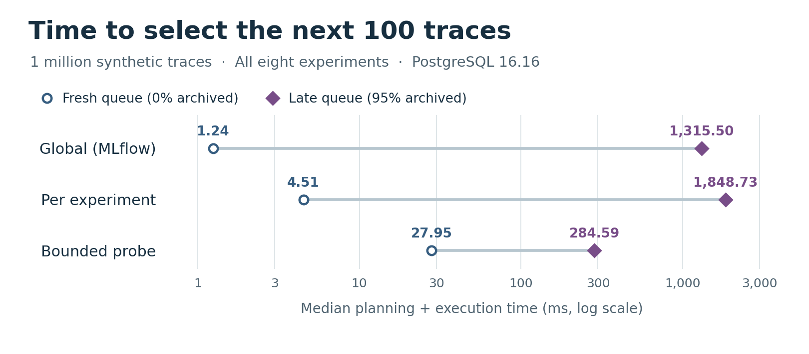

# MLflow Trace Archival Benchmark

[](https://github.com/kenchengkc/mlflow-trace-archive-bench/actions/workflows/postgres.yml)

A reproducible PostgreSQL benchmark for the query MLflow uses to select traces for archival. It compares three ways to find the oldest eligible traces, checks that they return identical rows in identical order, and records their execution plans.

When an MLflow user reported waiting minutes for PostgreSQL to select three traces, the maintainers added an index on timestamp and trace ID. This benchmark builds on that fix by testing what happens as the archive queue drains. MLflow contributors can use the same dataset to try a query change on a fresh queue and again after the oldest 95% of eligible traces have been archived. [Original issue](https://github.com/mlflow/mlflow/issues/24895) · [Upstream fix](https://github.com/mlflow/mlflow/pull/24976)

## Quick start

Inspect a published run with Git and Python 3.10+. The report reader uses only the Python standard library.

```sh
git clone https://github.com/kenchengkc/mlflow-trace-archive-bench.git
cd mlflow-trace-archive-bench
python3 summarize.py results/strategy-study/million-late.json.gz --with-planning
```

## Results

On PostgreSQL 16.16, each query selected **100 traces from one million synthetic traces** across eight experiments. Each figure is the median of six measurements and includes server planning and execution. The percentages refer to the share of initially eligible traces already archived, oldest first.



<details>
<summary>Exact timings and query descriptions</summary>

| Query | Selection strategy | 0% archived | 95% archived |
| --- | --- | ---: | ---: |
| Global (MLflow) | Find the oldest eligible traces across all selected experiments. | **1.24 ms** | 1,315.50 ms |
| Per experiment | Take up to 100 eligible traces from each experiment, then merge the results. | 4.51 ms | 1,848.73 ms |
| Bounded probe | Check the oldest matching trace headers first. If the batch is short and more headers remain, evaluate the full eligible set. | 27.95 ms | **284.59 ms** |

</details>

At 95% archived, the global query passed **853,678 trace headers** to subsequent checks to fill one batch. The bounded probe checked 200 headers, then switched to its fallback. A separate experiment traced most of the bounded probe’s first-batch overhead to PostgreSQL’s just-in-time compilation. [Query plans and compilation experiment](results/strategy-study/README.md)

Experiment selection changes the outcome. On 100,000 traces at 95% archived, the bounded probe used 26% of the global query’s time across all eight experiments and 125% when selecting only the rare experiment. The chart compares experiment 1 (frequent), experiment 8 (rare), and all eight at five stages of archival. [Full timing table](results/strategy-study/matrix.md)


## Reproduce the benchmark

On macOS or Linux, put the PostgreSQL server tools (`initdb`, `pg_ctl`, and `psql`) on your `PATH` and run the commands as a non-root user. The runner creates a temporary cluster on a private Unix socket and removes it on exit. To repeat the two million-trace workloads, run the following from the checkout.

```sh
python3 study.py --rows 1000000 --scope 1,2,3,4,5,6,7,8 \
  --archived-pct 0 95 --batch-size 100 --samples 6 --output study-result.json.gz
python3 summarize.py study-result.json.gz --with-planning --buffers
```

For a **SQL-only reproduction**, run the following against an existing scratch database named `scratch` with permission to create a schema. The script seeds 100,000 traces, prints all three query plans, verifies the ordered results, and drops its schema on success. [Standalone SQL](results/strategy-study/late-queue.sql)

```sh
psql -X -d scratch -f results/strategy-study/late-queue.sql
```

## Contributing

For query changes, include a test with the expected trace IDs in order and run `python3 -m unittest -v`. For performance findings, include the PostgreSQL version, command, and result JSON so others can inspect the plan. [Correctness tests](test_strategies.py) · [Project roadmap](ROADMAP.md)

## License

Copyright 2026 Ken Cheng. Distributed under the [Apache License 2.0](LICENSE).
