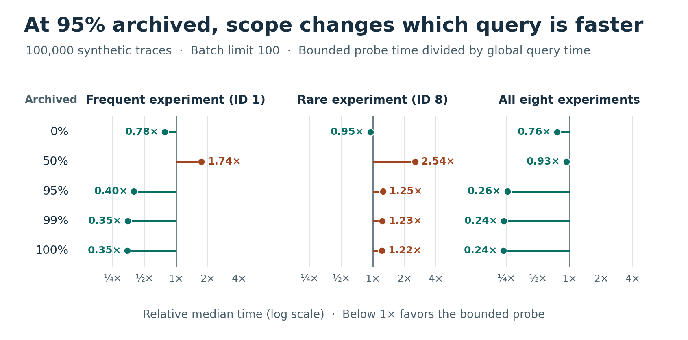

# MLflow Trace Archival Benchmark

[](https://github.com/kenchengkc/mlflow-trace-archive-bench/actions/workflows/postgres.yml)

A PostgreSQL benchmark for the query MLflow uses to choose its next batch of traces to archive. It compares three SQL strategies and checks that each returns the same traces in the same order.

MLflow added an index on timestamp and trace ID after a user reported waiting minutes to select three traces. This project builds on that fix by measuring what happens as the oldest traces leave the queue. [Operator report](https://github.com/mlflow/mlflow/issues/24895) · [Upstream fix](https://github.com/mlflow/mlflow/pull/24976)

## Results

On **one million synthetic traces**, MLflow’s global query selected the first batch of 100 in **1.24 ms**. After the oldest 95% of eligible traces had been archived, the same query took **1,315.50 ms**. An alternative that checks a short prefix of the queue took **284.59 ms** for that late batch.

<picture>
  <source media="(prefers-color-scheme: dark)" srcset="results/strategy-study/query-latency-dark.png">
  
</picture>

Measured on PostgreSQL 16.16. Each timing includes server planning and execution. Both workloads used all eight experiments and the same indexes. [Fresh-queue samples and plan](results/strategy-study/million-start.json.gz) · [Late-queue samples and plan](results/strategy-study/million-late.json.gz) · [How the queries work](results/strategy-study/README.md#three-queries-identical-answers)

<details>
<summary>Exact timings and observed ranges</summary>

Each cell gives the median followed by the minimum and maximum of six measured runs, in milliseconds.

| Query | Fresh queue | 95% archived |
| --- | ---: | ---: |
| Global (MLflow) | **1.24** (1.20–1.33) | 1,315.50 (1,311.40–1,331.15) |
| Per-experiment merge | 4.51 (4.38–4.69) | 1,848.73 (1,804.38–1,865.08) |
| Bounded probe | 27.95 (27.09–30.26) | **284.59** (282.93–287.06) |

</details>

At 95% archived, the global query passed 853,678 trace headers to its eligibility checks. The bounded probe checked 200 headers, then switched to filtering the full set. On the fresh queue, PostgreSQL’s just-in-time compilation accounted for most of the probe’s overhead. [Execution plans and controlled experiment](results/strategy-study/README.md#why-the-first-batch-was-slow)

## Quick start

Inspect the saved measurements with Git and Python 3.10+. The report reader uses only the standard library. This example selects the 100,000-trace workload with a batch limit of 100, 95% already archived, and only the rare experiment (ID 8).

```sh
git clone https://github.com/kenchengkc/mlflow-trace-archive-bench.git
cd mlflow-trace-archive-bench
python3 summarize.py results/strategy-study/matrix.json.gz \
  --scope 8 --batch-size 100 --archived-pct 95 --with-planning
```

For that workload the bounded probe took **21.52 ms**, compared with **17.26 ms** for the global query. At the same archive depth across all eight experiments, the probe used only 26% of the global query’s time. Remove the filters to inspect all 45 cases.

<picture>
  <source media="(prefers-color-scheme: dark)" srcset="results/strategy-study/scope-and-depth-dark.png">
  
</picture>

[Full timing table](results/strategy-study/matrix.md) · [Raw samples and query plans](results/strategy-study/matrix.json.gz) · [Workload and timing method](results/strategy-study/README.md#workload-and-timing)

## Reproduce the benchmark

On macOS or Linux, put the PostgreSQL server tools (`initdb`, `pg_ctl`, and `psql`) on your `PATH` and run the commands as a non-root user. The runner creates a temporary cluster on a private Unix socket and removes it on exit. To repeat the two million-trace workloads, run the following from the checkout.

```sh
python3 study.py --rows 1000000 --scope 1,2,3,4,5,6,7,8 \
  --archived-pct 0 95 --batch-size 100 --samples 6 --output study-result.json.gz
python3 summarize.py study-result.json.gz --with-planning --buffers
```

For a **SQL-only reproduction**, run the following against an existing scratch database named `scratch` with permission to create a schema. The script seeds 100,000 traces, prints all three query plans, verifies the ordered results, and drops its schema on success. [Standalone SQL](results/strategy-study/late-queue.sql)

```sh
psql -X -d scratch -f results/strategy-study/late-queue.sql
```

## Contributing

For query changes, include a test with the expected trace IDs in order and run `python3 -m unittest -v`. For performance findings, include the PostgreSQL version, command, and result JSON so others can inspect the plan. [Correctness tests](test_strategies.py) · [Project roadmap](ROADMAP.md)

## License

Copyright 2026 Ken Cheng. Distributed under the [Apache License 2.0](LICENSE).
