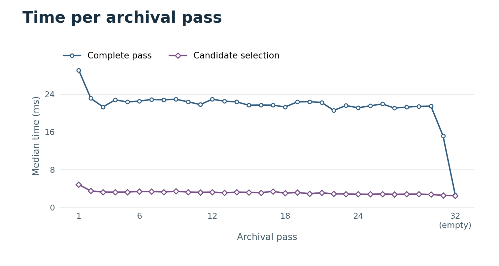

# MLflow’s archival candidate finder

These studies time MLflow’s selection of the oldest eligible traces through its SQLAlchemy tracking store. They cover queue layout, a two-step alternative, ordering when MLflow splits a request across two SQL queries, and the cost of draining a queue three traces at a time. [Project overview](../../README.md)

## Through MLflow’s database driver

MLflow 3.18.0 took **112.18 ms** to select 100 traces from the oldest-first queue and **4.84 ms** from the equally archived scattered queue. We ran its actual SQLAlchemy candidate finder on three 100,000-trace databases initialized by MLflow’s migrations. Every timed call returned the expected trace IDs, experiment IDs and timestamps in order, with the same result digest as the earlier raw SQL study. [Upstream finder](https://github.com/mlflow/mlflow/blob/ba41106d110b67096384da12b6b85473457598db/mlflow/store/tracking/sqlalchemy_store.py#L7151-L7230)

| Queue | MLflow finder (ms) | Raw global SQL (ms) | Replay of MLflow’s SQL (ms) |
| --- | ---: | ---: | ---: |
| Fresh | 1.70 | 0.94 | 0.95 |
| 95% archived, oldest first | 112.18 | 111.20 | 110.70 |
| 95% archived, scattered | 4.84 | 4.05 | 4.04 |

The raw column runs this repository’s global query directly. The replay runs the exact SQL and bound parameters captured from MLflow. Each value is the median of 12 caller-side measurements on PostgreSQL 16.16, from opening the managed session through fetching the batch, committing and closing the session. The methods shared one warm psycopg2 connection per queue and ran in all six possible orders. The finder’s median was 0.76 ms above raw SQL on the fresh queue and 0.98 ms above it on the oldest-first queue. [Timing samples, SQL and plans](../driver-study.json.gz) · [Benchmark run](https://github.com/kenchengkc/mlflow-trace-archive-bench/actions/runs/45670762246)

The earlier reduced-schema study measured server planning and execution alone. Its fresh-queue plan scanned 30,882 tag rows looking for a span-location tag. MLflow’s migration puts the tag key first in the primary index, while the reduced fixture puts the trace ID first. Both migrated plans used that index for the lookup and found zero matching tags. [Earlier plan](../strategy-study/matrix.json.gz) · [MLflow migration](https://github.com/mlflow/mlflow/blob/ba41106d110b67096384da12b6b85473457598db/mlflow/store/db_migrations/versions/867495a8f9d4_add_trace_tables.py#L57) · [Reduced schema](../../sql/schema.sql)

## Deferring the fallback

For a batch of 100, the two-step selector checks up to 200 of the oldest matching headers. If it fills the batch or finds fewer than 200 headers, it returns the eligible traces in order. Otherwise, it sends a second query that recomputes the entire batch. Both reads share a short, read-only, repeatable-read transaction. [Selector](../../two_step.py) · [Prefix query](../../sql/two_step_prefix.sql) · [Fallback query](../../sql/two_step_fallback.sql)

| Queue, 100,000 traces | MLflow finder (ms) | Single-statement probe (ms) | Two-step (ms) | Two-step fallback calls |
| --- | ---: | ---: | ---: | ---: |
| Fresh | 1.84 | 1.49 | **1.15** | 0/12 |
| 95% archived, oldest first | 112.71 | 28.46 | 28.96 | 12/12 |
| 95% archived, scattered | **5.36** | 27.72 | 27.41 | 12/12 |

Times are medians of 12 complete selection transactions per method, including checkout, isolation setup and commit on the same warm connection per queue. Every call returned the independently verified ordered batch. The two probes’ timing ranges overlapped within each archived layout. With archival scattered, two-step selection took **5.1× as long as MLflow’s finder**. For the rare experiment alone, all three medians were within 0.5 ms of one another on both archived queues. [Samples and plans](../two-step.json.gz) · [Rare experiment](../two-step-rare.json.gz) · [PostgreSQL 16.16 run](https://github.com/kenchengkc/mlflow-trace-archive-bench/actions/runs/45672585264)

The largest fresh-queue difference appeared at **one million traces**. The single-statement probe took **14.79 ms** and its plan showed 67 just-in-time compilation functions, even though the fallback executed zero times. The two-step selector sent only the prefix query, whose plan showed no compilation, and took **1.40 ms**. MLflow’s finder took **2.10 ms**. [Million-trace samples and plans](../two-step-million-fresh.json.gz)

To verify the order under concurrent writes, a test commits two changes on a second PostgreSQL connection between the probe and fallback. An older trace becomes eligible and a tied candidate is archived. The fallback returns the exact pre-commit batch, including both tied IDs in order. A new transaction sees both changes and agrees with MLflow’s finder. [Concurrency test](../../test_two_step.py)

## From 1,000 to 1,001 experiments

Adding experiment 1,001 to the selection triggered a second candidate query and increased median batch-selection time by **0.90 ms** on this fixture. We asked MLflow 3.18.0 for the oldest 100 traces on the same migrated PostgreSQL 16.16 database, with 101 eligible traces in each of 1,001 experiments. [MLflow’s finder and merge](https://github.com/mlflow/mlflow/blob/ba41106d110b67096384da12b6b85473457598db/mlflow/store/tracking/sqlalchemy_store.py#L7112-L7230)

| Selected experiments | Candidate SELECTs | Rows returned per SELECT | Rows kept per chunk | Median ms (min–max) |
| ---: | ---: | --- | --- | ---: |
| 1,000 | 1 | 100 | 100 | 2.68 (2.64–2.72) |
| 1,001 | 2 | 100 + 100 | 50 + 50 | 3.58 (3.52–3.73) |

Experiments 1,000 and 1,001 had traces with identical timestamps on either side of the chunk boundary. At the batch cutoff, trace ID `…0062` from experiment 1,000 ranked 100th and `…0063` from experiment 1,001 ranked 101st at the same timestamp. Every timed batch matched an independent global sort by timestamp and trace ID. Swapping the two experiments between chunks also preserved the exact order. [Fixture](../../chunk_fixture.py) · [Ordering test](../../test_chunk_study.py)

Timings cover 12 complete transactions per scope on one warm connection, alternating which scope ran first. The untimed query captures and replays verified the IDs, limits and row counts for each SELECT. [Raw samples, ordered rows and plans](../chunk-study.json.gz) · [Benchmark run](https://github.com/kenchengkc/mlflow-trace-archive-bench/actions/runs/45676900586)

## Archive three traces per pass

On PostgreSQL 16.16 with local file storage, MLflow 3.18.0 took a median **22.14 ms** to archive a full batch of three traces. Selecting those traces took **3.11 ms**. Across all 210 full batches, selection accounted for **14.3%** of elapsed time. On the final empty pass it accounted for **94.6%**.

| Traces archived per pass | Measured passes | Median selection (ms) | Median complete pass (ms) |
| ---: | ---: | ---: | ---: |
| 3 | 210 | 3.11 | 22.14 |
| 2 | 7 | 2.58 | 15.14 |
| 0 | 7 | 2.51 | 2.65 |



Each point is the median for that pass number across seven fresh queues. Each queue held 92 eligible traces across three experiments, with a root and child span per trace. Passes 1–30 archived three traces each, pass 31 archived the remaining two, and pass 32 confirmed the queue was empty. Selection includes experiment and retention lookups, the candidate query, and ordering. The complete pass includes selection, span serialization, local file writes, and database finalization. Readback runs after timing. [Pass timer](../../drain_measure.py) · [Per-pass measurements](../drain-study.json.gz) · [PostgreSQL run](https://github.com/kenchengkc/mlflow-trace-archive-bench/actions/runs/45955942205)

The fixture logged traces in reverse archival order, with four traces sharing each timestamp. Every pass selected and successfully archived exactly the expected IDs in timestamp and trace-ID order, including ties split between passes. Across all seven queues, the benchmark verified **644 archive files** and **1,288 cleared database span payloads**. MLflow’s `get_trace` read back every root and child span, and each matched its original contents. [Fixture and readback checks](../../drain_fixture.py)

To repeat the run, [install the driver dependencies](#reproduce-these-studies) and run this command from the repository root.

```sh
.venv/bin/python drain_study.py --rounds 7 --traces 92 --output drain-study.json.gz
```

To redraw the chart from your own report, run `python3 results/finder/plot_drain.py --input drain-study.json.gz --output drain-pass-times.png` with Matplotlib installed.

### Where a three-trace pass spends its time

**Database finalization took 9.99 ms per full pass and loading the spans took 6.35 ms.** Together they accounted for **86.0% of the time outside candidate selection**. Writing the three local archive files took 1.67 ms, and serializing their contents took 0.54 ms.

The original full-pass median was **22.14 ms**. For this comparison, one PostgreSQL 16.16 runner measured the workload twice. The control used the original timers (**22.12 ms** median). The second run added four timers inside each pass (**22.23 ms** median). Each run drained seven fresh queues of 92 traces. The table gives mean times across the 210 full passes with phase timing enabled. Shares use total elapsed time across those passes. [Control measurements](../drain-phase-control.json.gz) · [Per-pass phase timings and call counts](../drain-phase-study.json.gz) · [Benchmark run](https://github.com/kenchengkc/mlflow-trace-archive-bench/actions/runs/45958568812)

| Phase | Mean ms per three-trace pass | Share of elapsed time |
| --- | ---: | ---: |
| Select candidates | 3.13 | 14.1% |
| Load span rows and trace metadata, then check eligibility | 6.35 | 28.7% |
| Decode stored spans and serialize to protobuf | 0.54 | 2.4% |
| Stage the protobuf and write the local archive file | 1.67 | 7.6% |
| Recheck the trace, clear database span contents, update tags, and commit | 9.99 | 45.1% |
| Other work, including session handling outside the timers and repository setup | 0.46 | 2.1% |
| **Complete pass** | **22.15** | **100%** |

Each archived trace called all four timed operations once, in order. The seven empty passes called none. The intervals and residual account for each complete pass before rounding. All 224 profiled passes returned the same ordered IDs as the control, including ties across batch boundaries. After timing, MLflow read back all 1,288 spans from 644 archive files and matched them to the inputs. [Timing code](../../drain_measure.py) · [MLflow archival path](https://github.com/mlflow/mlflow/blob/ba41106d110b67096384da12b6b85473457598db/mlflow/store/tracking/sqlalchemy_store.py#L7232-L7481)

To repeat the breakdown, use the same setup as the drain benchmark and enable phase timing.

```sh
.venv/bin/python drain_study.py --rounds 7 --traces 92 --profile-phases --output drain-phase-study.json.gz
```

## Reproduce these studies

Run the commands from the repository root. The runner uses a disposable PostgreSQL cluster and initializes the tracking tables with MLflow’s migrations. [PostgreSQL prerequisites](../../README.md#reproduce-the-benchmark)

Install the pinned MLflow release and driver, then compare the finder, raw SQL and a replay of MLflow’s SQL on all three queues.

```sh
python3 -m venv .venv
.venv/bin/python -m pip install -r requirements-driver.txt
.venv/bin/python driver_study.py --output driver-study.json.gz
```

Verify the two-step selector under concurrent writes, then reproduce its three published comparisons. The first run selects all eight experiments, the second selects the rare experiment, and the third uses the fresh million-trace queue.

```sh
.venv/bin/python -m unittest -v test_two_step
.venv/bin/python two_step_study.py --output two-step.json.gz
.venv/bin/python two_step_study.py --scope 8 --output two-step-rare.json.gz
.venv/bin/python two_step_study.py --rows 1000000 --fresh-only --output two-step-million-fresh.json.gz
```

To compare 1,000 and 1,001 selected experiments on the same database and verify the merged order, run the chunk study.

```sh
.venv/bin/python chunk_study.py --output chunk-study.json.gz
```
