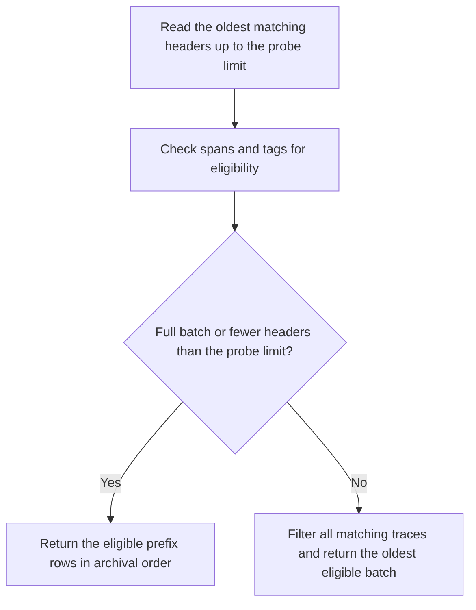

# Choosing the next traces to archive

The shipped index lets PostgreSQL walk traces in archival order. That is cheap when the oldest rows qualify. Once the oldest rows have moved out of the tracking store, the same walk can spend most of its time checking rows that will never be returned.

## Three queries, identical answers

| Query | How it chooses the next batch |
| --- | --- |
| [Global](../../sql/candidates.sql) | Applies MLflow’s eligibility rules across the selected experiments and returns the oldest K traces, breaking timestamp ties by ID. |
| [Per experiment](../../sql/per_experiment.sql) | Takes the oldest K eligible traces per experiment, then merges and limits the combined rows. A trace ranked below K in its own experiment cannot enter the global first K. This implements the operator’s suggested approach in one SQL statement. |
| [Bounded probe](../../sql/bounded_probe.sql) | Examines the oldest matching trace headers, up to twice K with a cap of 4,096. It checks their spans and tags. If that fills the batch or exhausts the headers, it returns the prefix’s eligible rows. Otherwise it recomputes eligibility across the selected experiments and sorts those results. |

### How the bounded probe chooses a batch



For a batch of 100, the probe limit is 200 headers. If only 150 matching headers exist, the probe has seen them all and can return a partial batch. If it sees 200 and finds only 99 eligible traces, it takes the fallback. Both branches see the same database snapshot. The cap applies to headers passed to eligibility checks. PostgreSQL may read more index entries or pages to find them.

## What changed at one million traces

For a batch of 100 across all eight experiments, 95% archived:

| Representative plan | Global | Per experiment | Bounded |
| --- | ---: | ---: | ---: |
| Median planning + execution | 1,315.50 ms | 1,848.73 ms | 284.59 ms |
| Shared-buffer accesses | 4,578,536 | 4,651,686 | 61,117 |

The global query’s ordered scan returned 853,678 trace headers into subsequent checks. The bounded query examined 200 headers, found no qualifying rows, and ran its fallback. The fallback produced 36,191 eligible rows for the final top-100 sort. Buffer counts are root-level hits plus reads and include repeated visits to a page. [Late-queue raw plans](million-late.json.gz)

With 0% archived, the global query took 1.24 ms and the bounded query took 27.95 ms. The bounded query filled the batch from its prefix. Its full eligibility branch executed zero times. PostgreSQL nevertheless reported 68 just-in-time (JIT) compilation functions in that query’s plan. PostgreSQL decides whether to compile using the estimated cost of the whole plan. [Early-queue raw plans](million-start.json.gz) · [PostgreSQL JIT decisions](https://www.postgresql.org/docs/16/jit-decision.html)

## Why the first batch was slow

A follow-up run alternated the same bounded SQL with JIT enabled and disabled on the same fixture. Each setting ran six times, with the first setting alternating every round. The database returned the same ordered rows and the same estimated plan cost in each mode.

| Oldest traces archived | JIT on | JIT off | Full fallback executions per query |
| ---: | ---: | ---: | ---: |
| 0% | 26.04 ms | 1.65 ms | 0 |
| 95% | 288.00 ms | 254.47 ms | 1 |

At 0%, the planner estimated a cost of 301,090 against a JIT threshold of 100,000. The query compiled 68 functions with JIT enabled despite taking the short path. Switching off compilation removed about 24 ms of the first-batch latency on this fixture. The experiment changes a session setting for the measured query. A production choice would also need to account for other queries sharing a connection. [Paired raw timings and plans](million-jit.json.gz) · [Control run](https://github.com/kenchengkc/mlflow-trace-archive-bench/actions/runs/45576509086)

## Workload and timing

- The 100,000-trace matrix crosses three scopes (frequent experiment 1, rare experiment 8, all eight), batch limits of 3, 100 and 1,000, and 0%, 50%, 95%, 99% and 100% archival. Archival percentage refers to the oldest initially eligible traces across the eight-experiment population. Each report includes the actual remaining count for the selected scope. [Full table](matrix.md) · [All timings and plans](matrix.json.gz)
- For each size and archive percentage, the runner starts a fresh PostgreSQL cluster, seeds deterministic data, simulates archival, refreshes statistics, and installs the shipped archival index. All three variants run on that same fixture. Correctness tests independently cover missing and empty spans, failure tags, rare and absent experiments, tied timestamps, arrivals between batches, and batch sizes above the prefix cap. [Fixture](../../sql/seed.sql) · [Tests](../../test_strategies.py)
- Each query gets an instrumented warm-up. The six measured rounds cover every ordering of the three strategies. Each timing uses a new client session. The headline metric adds PostgreSQL’s reported planning and execution time **for each sample** before taking the median. Connection setup, network transfer and artifact uploads are outside this interval. Each saved plan is the sample nearest the median **execution** time. [Measurement code](../../study.py) · [PostgreSQL 16 run](https://github.com/kenchengkc/mlflow-trace-archive-bench/actions/runs/45575683264)
- These comparisons cover complete SQL rewrites. They change how the planner sees experiment and tag filters as well as how it searches the queue. Absolute times depend on the machine, planner statistics, data distribution and cache state. The fixture uses short synthetic spans, one experiment chunk, literal parameters and an idle database. The reported time covers candidate selection in the open-source tracking store.

## Replay

```sh
# From the repository root, print the published measurements with plan buffer counts.
python3 summarize.py results/strategy-study/matrix.json.gz --with-planning --buffers

# Repeat the two scale cases locally.
python3 study.py --rows 1000000 --archived-pct 0 95 --scope 1,2,3,4,5,6,7,8 --batch-size 100 --samples 6 --output study-result.json.gz
```

Add `--jit-control` to repeat the compilation experiment, then run `summarize.py --with-planning` on the report.

To regenerate the README charts from the published reports, install Matplotlib in your plotting environment and run `python3 results/strategy-study/plot.py` from the repository root.

For a self-contained SQL example, run `psql -X -d scratch -f results/strategy-study/late-queue.sql` from the checkout. It uses regular PostgreSQL tables in a fresh schema, prints all three plans, and verifies the ordered rows. A failed run may leave the printed schema in the scratch database. [Standalone SQL](late-queue.sql) · [SQL exporter](../../reproduce.py)
